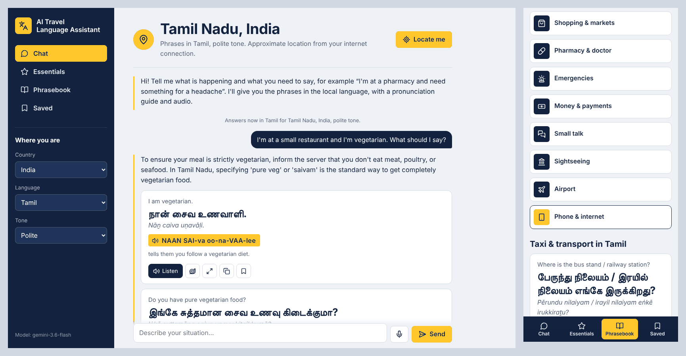

# AI Travel Language Assistant

Large Language Models project (Karunya 26CS302, project 7): *enter a travel situation → get useful
phrases, translations and pronunciation guidance.*

A travel chatbot that knows where you are. Describe your situation in English and it answers with the
phrases to say in the local language, each with the native script, a romanization, an easy
pronunciation guide, a usage note and audio.



## Features

- **Chat**: describe a situation or ask what to say ("How do I ask for the bill?", "What does இல்லை mean?").
  Follow-up questions keep the context ("say it more politely").
- **Knows where you are**: tap 📍 *Locate me* or choose a country. The local languages are proposed, the
  region's own language first (Tamil Nadu → Tamil, Catalonia → Catalan, Québec → French, KwaZulu-Natal → Zulu),
  and answers use the local variety, customs and currency.
- **165 languages, 212 countries and territories**, including the regional languages of India, Spain,
  Switzerland, Belgium, Canada, Pakistan, Nigeria, South Africa and others.
- **Essentials**: 23 basic phrases (greetings, understanding each other, getting by, numbers, emergencies).
- **Phrasebook**: 12 topics (restaurant, transport, hotel, directions, shopping, pharmacy, emergencies,
  money, small talk, sightseeing, airport, phone) or any situation you type.
- **On every phrase**: listen (normal or slow, with the local accent when a voice is installed), show it
  full screen to a local, copy, save.
- **Saved** phrases stay on the device. Voice input for the chat (Chrome, Edge). Mobile-first, dark mode.
- **Reliable output**: JSON schema in the prompt, validation of every field, one automatic retry,
  prompt-injection guard, rate limit and security headers.

## How it works

```
Browser: chat, tabs, audio, saved phrases (templates/, static/)
   │  JSON
   ▼
app.py        Flask routes: /api/chat  /api/phrases  /api/essentials  /api/locate  /api/config
   ├── assistant.py  prompts, request validation, answer parsing, retry
   ├── catalog.py    languages, countries → local languages, essentials, topics (data/*.json)
   ├── geo.py        GPS position → country and region (OpenStreetMap Nominatim)
   └── llm.py        Gemini or any OpenAI-compatible API (OpenAI, Groq, Ollama…), offline demo client
```

## Quick start

```bash
pip install -r requirements.txt
cp .env.example .env        # Windows: copy .env.example .env   — then paste your API key into .env
python app.py               # open http://localhost:5000
```

Get a free Gemini API key at <https://aistudio.google.com/apikey>. Without a key the app starts in
**demo mode**: it replays the answers recorded from Gemini 3.6 Flash for the evaluation (one situation
per language) and the Essentials tab is unavailable.

On Windows, if `python` opens the Microsoft Store, run `py app.py`, or turn off the *App execution
aliases* for python.exe in the Windows settings.

### Docker

```bash
docker build -t travel-language-assistant .
docker run -p 5000:5000 --env-file .env travel-language-assistant
```

## Configuration (`.env`)

| Variable | Default | Meaning |
|---|---|---|
| `LLM_API_KEY` | none (demo mode) | API key of the model provider |
| `LLM_BASE_URL` | Gemini OpenAI-compatible endpoint | any Chat Completions endpoint, e.g. `http://localhost:11434/v1` for Ollama |
| `LLM_MODEL` | `gemini-3.6-flash` | model name |
| `RATE_LIMIT_PER_MINUTE` | `30` | model requests allowed per user and minute |

## API

| Method | Path | Body | Answer |
|---|---|---|---|
| GET | `/api/config` | | languages, countries, topics, essentials |
| POST | `/api/locate` | `lat`, `lon` | `country`, `region`, `place`, `languages` (most useful first) |
| POST | `/api/chat` | `message`, `history`, `language`, `politeness`, `country`, `region` | `reply`, `phrases`, `tips` |
| POST | `/api/phrases` | `situation` or `topic`, `count`, `language`, `politeness`, `country`, `region` | `title`, `phrases`, `tips` |
| POST | `/api/essentials` | `language`, `politeness`, `country`, `region` | the 23 essential `phrases` |
| GET | `/health` | | `status`, `model` |

Each phrase has `english`, `translation`, `romanization`, `pronunciation` and `note`.

## Evaluation

`evaluate.py` runs 10 situations in 10 languages and checks every answer automatically.
Results with **Gemini 3.6 Flash** (answers in `demo_responses.json`, scored with
`python evaluate.py --responses demo_responses.json`):

| Metric | Pass rate |
|---|---|
| Valid JSON | 100 % |
| All fields filled | 100 % |
| Requested number of phrases | 100 % |
| Translation in native script | 100 % |
| Romanization in Latin letters | 90 % |
| Latin-letter pronunciation | 100 % |
| 2 cultural tips | 100 % |

The only automatic failure is Thai: two romanizations kept Thai characters. A manual
review of the 24 French, Spanish, Italian and German phrases found all translations
correct and 4 pronunciation guides with a wrong stress or an approximate sound.

The prompts added in version 2 (chat, essentials, topics with a location) were checked live with
Gemini 3.6 Flash for Tamil in Tamil Nadu: the three raw answers in `results/live_check_v2.json` all
pass the validators (4 chat phrases, 23 essentials, 8 transport phrases, Tamil script everywhere,
Latin romanizations). One essential is ungrammatical: "Do you speak English?" became
"உங்களுக்கு ஆங்கிலம் பேசுமா?" instead of "உங்களுக்கு ஆங்கிலம் பேசத் தெரியுமா?", a reminder that
the answers need a native speaker's check.

## Tests

```bash
pip install -r requirements-dev.txt
python -m pytest
```

37 tests with a fake model and a fake geocoder: request validation, prompts, answer parsing and
retry, script checks, location → languages, API routes, rate limit, demo mode and security headers.

## Project structure

```
app.py               Flask routes, rate limit, security headers
assistant.py         prompts, request validation, answer parsing, retry
catalog.py           languages, countries → local languages, essentials, topics
geo.py               reverse geocoding with OpenStreetMap Nominatim
llm.py               OpenAI-compatible client and offline demo client
evaluate.py          10-language benchmark
data/                languages.json (165 languages), countries.json (212 countries and territories)
templates/, static/  web interface
tests/               pytest suite
results/             evaluation results, live check, screenshots
```

## Privacy and limitations

- The position is used only when you tap *Locate me*: it is rounded to about 100 m and sent once to
  OpenStreetMap Nominatim to find the country and region. Nothing is stored on the server.
- Settings and saved phrases stay in the browser (localStorage).
- Phrases are generated by a language model and can be wrong, especially in less-resourced languages:
  check anything important (allergies, medicine) with a local.
- Audio depends on the voices installed on the device; Microsoft Edge offers the most.
- The free Gemini tier has daily quotas.
