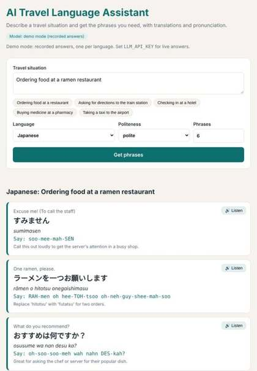

# AI Travel Language Assistant

Describe a travel situation and get the phrases you need in the local language, with
a translation in the native script, a romanization, an easy pronunciation guide and a
🔊 button to hear it.

**Course:** 26CS302 Large Language Models, Karunya Institute of Technology and Sciences (project 7)
**Team:** Marc-Antoine Allain (ISK26CS1004) · Clémence Audebert (ISK26CS1008)



## Features

- 12 languages: Arabic, French, German, Hindi, Italian, Japanese, Korean, Mandarin Chinese, Portuguese, Spanish, Tamil, Thai
- Phrases ordered by usefulness, adapted to the chosen politeness level (casual, polite, formal)
- Native script, standard romanization and an English-style pronunciation respelling
- Audio playback with the browser's speech synthesis (no extra API)
- Two cultural tips per situation
- JSON API, Docker image, offline demo mode and an automatic evaluation script

## How it works

```
situation, language ──► prompt template ──► LLM (any OpenAI-compatible API) ──► JSON
        ▲                                                                       │
   web form (Flask)  ◄──── phrase cards + 🔊 ◄──── validation + one retry ◄──────┘
```

1. `assistant.py` validates the request and builds the prompt: a system prompt that fixes
   the role, the JSON schema and the pronunciation conventions, plus the user's situation
   between delimiters so that instructions hidden in it are ignored.
2. `llm.py` sends the chat messages to the model (Google Gemini by default, or Ollama,
   Groq, OpenAI…) and returns its text.
3. The JSON answer is parsed and validated; if it is malformed the request is retried once.
4. The page shows one card per phrase; the 🔊 button reads the translation aloud.

## Quick start

```bash
pip install -r requirements.txt
cp .env.example .env        # then paste your API key into .env
python app.py               # open http://localhost:5000
```

Without an API key the app starts in **demo mode** and replays the answers recorded from
Gemini 3.6 Flash during the evaluation (one situation per language).

### Docker

```bash
docker build -t travel-language-assistant .
docker run -p 5000:5000 --env-file .env travel-language-assistant
```

### API

```bash
curl -X POST http://localhost:5000/api/phrases -H "Content-Type: application/json" \
     -d '{"situation": "Ordering food at a restaurant", "language": "Japanese", "politeness": "polite", "count": 6}'
```

## Evaluation

`evaluate.py` runs 10 situations in 10 languages and checks every answer automatically.
Results with **Gemini 3.6 Flash** (answers in `demo_responses.json`, scored with
`python evaluate.py --responses demo_responses.json`):

| Metric | Pass rate |
|---|---|
| Valid JSON | 100 % |
| All fields filled | 100 % |
| Requested number of phrases | 100 % |
| Translation in native script | 100 % |
| Romanization in Latin letters | 90 % |
| Latin-letter pronunciation | 100 % |
| 2 cultural tips | 100 % |

The only automatic failure is Thai: two romanizations kept Thai characters. A manual
review of the 24 French, Spanish, Italian and German phrases found all translations
correct and 4 pronunciation guides with a wrong stress or an approximate sound.

## Tests

```bash
pip install -r requirements-dev.txt
pytest
```

## Project structure

```
app.py               Flask routes: web page, /api/phrases, /health
assistant.py         validation, prompt, JSON parsing, retry
llm.py               OpenAI-compatible client and offline demo client
evaluate.py          benchmark and automatic metrics
demo_responses.json  answers recorded from Gemini 3.6 Flash
templates/, static/  web interface (HTML, CSS, JavaScript)
tests/               unit and API tests (pytest)
results/             evaluation results and screenshot
```

## Limitations

Machine-generated phrases can contain mistakes, especially in pronunciation guides and
for tonal languages: they help travellers but do not replace a native speaker. The
quality of the 🔊 voice depends on the voices installed on the device.
